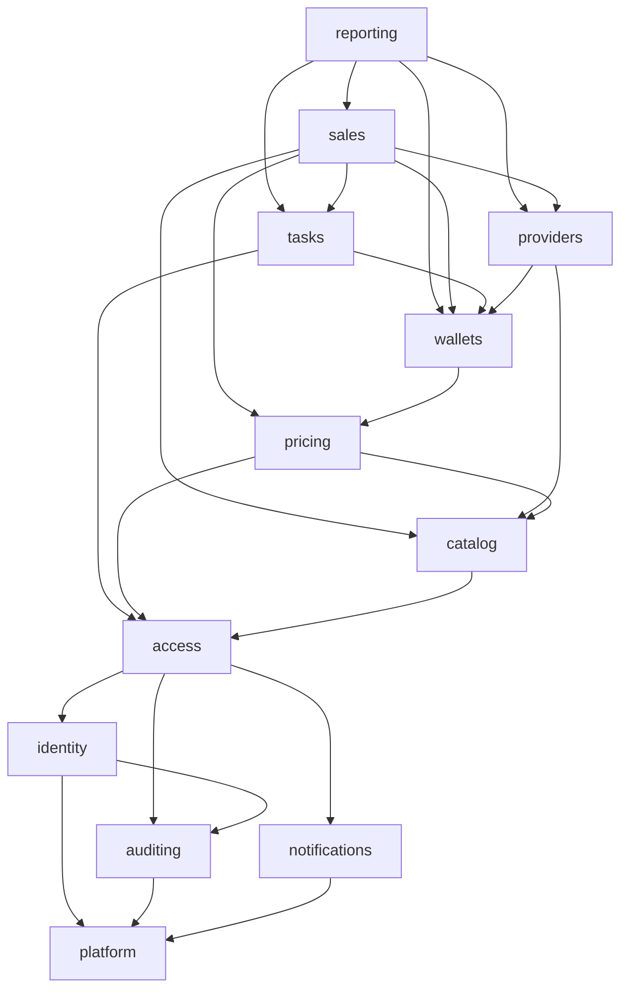

# Backend architecture audit and the plan to retire `office`

- **Date:** 2026-11-13
- **Base commit:** `626f61b5b0b6b14ccd5093bcff91f777d9b64420`
- **Status:** analysis and design only. Nothing is moved, renamed or migrated by this document. Each slice below
  needs the owner's approval, and its own spec and plan (`work-plan.mdc`), before it starts.
- **Scope read:** `apps/api/src` (all of it), `apps/api/prisma/schema.prisma`, the web's API callers and tests,
  the worker, `docs/architecture/backend.md`, ADR 0012, `architecture.spec.ts`.
- **Not done:** an exhaustive unused-export scan (section 2.6 says what was and was not checked).

Numbers are measured at the base commit by scripts over the tracked files; production code means `*.ts` without
`*.spec.ts`, `testing/` and `generated/`.

## 1. What the backend is today

### 1.1 Shape

| Area | Files | Lines | Spec files |
|---|---|---|---|
| `modules/office/` (20 folders + 3 root files) | 181 | 17,889 | 81 |
| `modules/auth/` | 21 | 3,145 | 18 |
| `modules/branding/` | 6 | 305 | 2 |
| `modules/shared/` | 16 | 745 | 9 |
| `src/` root (bootstrap, middleware, worker, CLI scripts, `provider-dispatch.ts`) | — | — | — |

`office` is 81% of the application code. It is **not** one module in the Nest sense: since ADR 0012 it is an
umbrella folder over sixteen Nest modules (`OfficeModule` only imports them and registers the duplicate-write
guard), a kernel, a rules folder, a testing folder and three root files. The name carries no boundary; it is the
historical word for "everything behind a door session".

### 1.2 What each folder really does

| Folder | Lines | Real responsibility | Note |
|---|---|---|---|
| `kernel/` | 371 | `UnitOfWork` (client, `runTx`, notices after commit), `AccountTree`, `ActorResolver`, `ActorInterceptor`, shared types | infrastructure and access mixed |
| `policy.ts` | 69 | who may do what (`requireGrant`, `requireOwner`, `refuseEntered`) | access |
| `rules/` | 1,021 | twelve pure rule files used by two to sixteen folders each | owned by nobody |
| `stored-text.ts` | 34 | the Arabic notes the API stores on tasks | tasks and providers |
| `accounts/` | 850 | accounts, access, freeze, password, enter and leave (impersonation hand-off) | reaches into `auth` five times |
| `roles/` | 210 | roles and layer roles | access |
| `activity/` | 311 | the audit trail's writer (decorator, interceptor, recorder, purge) | used by `auth` and `branding` too |
| `audit/` | 186 | reading and exporting the audit trail | reporting |
| `notices/` | 424 | notices: writer (`NoticeService`), inbox, SSE stream | the writer is provided by the kernel |
| `catalog/` | 211 | the shipped catalog and its seed at boot | catalog |
| `companies/` | 282 | companies, SIM rules, images | catalog |
| `packages/` | 764 | packages, modes, details, renewal chains, switches, sell prices | catalog and pricing |
| `offers/` | 330 | offers shown to a layer | catalog |
| `terms/` | 835 | per-account package terms, custom prices, line prices, `PriceLadder` | pricing |
| `wallets/` | 1,222 | `WalletLedger` (the only writer of a wallet), funding, ceilings, finance reads | money |
| `providers/` | 3,603 | five things: provider settings; our account with a provider (ledger, payments, statements, reconciliation); health; the provider's catalog (simulated); and the integration (gateway, dispatch gate, operations, adapters registry) | the largest folder |
| `outbox/` | 120 | the outbox table's relay | infrastructure |
| `tasks/` | 918 | the task's life (open, take, release, reject, cancel, notes), its hold | workflow |
| `lines/` | 3,371 | five things: selling a line (activate); line operations; line reads; **task completion**; **activation settlement and people's decisions** (ADR 0019) | sales and workflow mixed |
| `transfers/` | 576 | moving an account or a line under another parent | accounts and lines |
| `reports/` | 388 | reports, insights, CSV | reporting |
| `desk/` | 690 | `me`, home, overview, daily line snapshots (a timer) | reporting and identity |
| `testing/` | 1,069 | in-memory office, the graph wired by hand, the HTTP spec app, route and permission tables | test only |

### 1.3 What is already right (and must not be lost)

- `architecture.spec.ts` holds 24 ratchet rules, **all at 0**: only the ledger writes a wallet, writes that belong
  together share a transaction, status changes are guarded, services ask the policy, bodies and queries are parsed
  by schemas, every write is recorded, no query in a service, no cross-domain repository import, no test code in
  production, `process.env` read in one file.
- The Nest module graph has **no cycle and no `forwardRef`**.
- Repositories hold almost no branching (the exception is `provider-operations.repository.ts`, 12 branches for
  guarded moves), and office controllers are thin (0–2 branches each).
- The API import graph never reaches the adapters registry; the worker's settings are checked before anything opens.
- Money: `WalletLedger` is the single writer; the lock order is stated and tested per domain (section 2.5).

The system is already a modular monolith. The work below is about **names, a few inverted dependencies and two
overloaded folders**, not about a new architecture.

## 2. Findings, by severity

Severity is about what a mistake would cost when S.12b puts real providers behind this code.

### 2.1 High

**H1. `lines/` and `tasks/` are one tangle at file level.** The Nest graph is `LinesModule → TasksModule`, but files
import both ways: `lines → tasks` 10 imports, `tasks → lines` 5.

- `tasks/tasks.service.ts` and `tasks/task-operation.ts` import `lines/activation-settlement.rules`
  (`taskActions`, `holdOf`, `mayDecide`, `sameRequest`, `shownPhase`), `lines/esim-code` and `lines/line-state`
  (`assertClaimFree`, `lockClaim`, `lockLine`).
- `tasks/tasks.repository.ts` imports `lines/esim-code` (`assertStoredSealed`): a rule inside a repository's file.
- `lines/task-completion.ts`, `lines/activation-settlement.ts` and `lines/provider-decisions.ts` import
  `tasks/task-operation` and `TasksService`.

The rules that say what a task may do while its provider operation is in flight live in `lines`; the locks a task
takes live in `lines`; the completion of a task lives in `lines`. Whoever changes one must read both folders, and
this is exactly the code ADR 0019 protects.

**H2. The worker builds the money path by hand, a second time.** `src/provider-dispatch.ts` constructs
`AccountTree`, `PriceLadder`, `WalletLedger`, `LinesRepository`, `TasksService`, `TaskCompletion`, `LinePricing`,
`ActivationSettlement`, `ProviderOperationsService`, the relay and the dispatcher with `new`, beside the Nest
modules that build the same classes for the API. A constructor that gains a parameter compiles in both, but a
collaborator added to a Nest module (an interceptor, a decorated provider) is silently absent in the worker. The
file is at `src/` root and imports 13 files of `providers`, 5 of `lines`, 2 of `tasks`: the worker's composition
root is domain code living outside every domain.

**H3. The kernel depends on the domains it serves.**

- `kernel/unit-of-work.ts` and `kernel.module.ts` import `notices/notice.service`: the notice writer is provided by
  the kernel, not by `NoticesModule`.
- `kernel/kernel.providers.ts` imports `LineAccess` (lines), `LayerRoles` (roles), `PriceLadder` (terms) and
  `WalletLedger` (wallets) to list them for test apps: a production file in the kernel that exists for tests.
- `kernel/actor-resolver.ts` and `KernelModule` import `auth` (the store, `AuthModule`), and `KernelModule`
  re-exports `AuthModule` to every domain.
- `kernel/line-terms.ts`, `kernel/sale.ts` and `kernel/types.ts` (`Action`) are sales vocabulary.

So "kernel" is infrastructure (`UnitOfWork`), access (`ActorResolver`, `ActorInterceptor`), hierarchy
(`AccountTree`), notifications and sales types under one name, and five file-level cycles pass through it
(`lines`, `wallets`, `terms`, `roles`, `notices`).

### 2.2 Medium

**M1. `providers/` is five domains in one module** (section 1.2). `ProvidersModule` exports four services; the
integration (gateway, dispatch, operations) is the part S.12b touches, and it shares a module, a repository file
name and a schemas file with statements, reconciliation and settings.

**M2. `rules/` is a shared grab-bag.** `account-visibility` is imported by 14 files, `prices` by 16, `user-terms` by
13. Three of the twelve files are named `office-*` (`office-grants`, `office-paging`, `office-terms`). No domain
owns a rule, so nothing says who may change it.

**M3. Infrastructure is keyed on the `/office` path prefix.**

- `shared/duplicate-guard.interceptor.ts:147`: idempotency applies only when `path.startsWith('/office/')`.
- `rate-limit.middleware.ts`: `/office/handoff` counts as a sign-in; `/office/notices/stream` is exempt.
- `door.middleware.ts`: `/office/handoff` starts a session.

A route that leaves the prefix silently loses its idempotency guard. This is the main hazard of any path change.

**M4. `auth ↔ activity`.** `auth` and `branding` import `office/activity` (the recorder); `activity` imports
`auth/session-token`. The audit writer is a cross-cutting service placed inside `office`.

**M5. `auth.controller.ts` holds logic:** 613 lines, 35 routes, 42 branches, and it writes activity itself. Every
other controller is thin.

**M6. Sideways imports between peers** that should go through a shared owner: `wallets → providers/match-simulator`
(while `providers → wallets`), `audit → reports/report-csv`, `providers.schemas → wallets.schemas` (`ceilingValue`),
`notices/notice-kinds → transfers/transfer-rules`, `lines/line-reads → tasks/task-access`.

### 2.3 Low

- **L1.** Domain CLI scripts at `src/` root: `reservation-conflicts.ts`, `seal-esim-codes.ts`, `seal-secrets.ts`,
  `two-factor-methods.ts` (run from `package.json`), each importing domain code upward.
- **L2.** `OfficeFailure` in `modules/shared/office-failure.ts` (110 uses) is the API's general failure, used by
  `auth` and `branding` as well.
- **L3.** `OFFICE_CONTROLLERS` / `OFFICE_PROVIDERS`: the same lists as the modules, flat, kept for HTTP specs.
- **L4.** `transfers/` straddles accounts (move an account) and lines (move a line).
- **L5.** `desk/` mixes the signed-in account's identity (`me`) with reporting (overview, snapshots).
- **L6.** `docs/architecture/backend.md` still has a row "`activity` (in `office/activity.module.ts`)" beside the
  real `office/activity/` row.

### 2.4 Business logic outside its place

- Controllers: only `auth.controller.ts` (M5).
- Repositories: `tasks.repository.ts` calls `assertStoredSealed` (a guard before a write: defensible, but it makes
  the repository import another domain's rule); `provider-operations.repository.ts` holds the guarded status moves
  (correct by rule 2.1: the guard is the `WHERE`).
- Rules in the wrong domain: H1.

### 2.5 Transactions and row locks

| Folder | `runTx` call sites | Lock statements (`FOR UPDATE` and kin) |
|---|---|---|
| `lines` | 18 | 2 |
| `providers` | 13 | 2 |
| `tasks` | 6 | 2 |
| `wallets` | 2 | 5 |
| `outbox` | 0 | 2 (`SKIP LOCKED`) |
| `accounts`, `terms`, `transfers` | 2 each | 0 |
| `offers`, `packages`, `kernel`, `auth` | 1 each | 0 |

- One transaction primitive: `UnitOfWork.runTx` (Read Committed; notices published after commit).
- The lock order is stated in two places and spans four folders: **task → claim keys (serial, number) → provider
  operation → wallet** (`provider-decisions.ts`), and **a line before any wallet, two wallets in sorted order**
  (backend map, `wallet-ledger.ts`). It is proved by the PostgreSQL specs of each flow, but no single place states
  the whole chain and no guard checks it. `lockedTask`, `lockedTaskOperation` live in `tasks`; `lockLine`, `lockClaim` in `lines`; `lockWallets` in
  `wallets`.
- **Rule for the whole refactor: no slice changes the body of a transaction, the order of its statements, or the
  file-local order of locks. A move is `git mv` plus import paths.**

### 2.6 Duplication and unused code

Checked: `tsc` runs with `noUnusedLocals`, and `unused-injection` is at 0, so unused locals and injections do not
exist. Found by reading:

- the second wiring of the money path (H2);
- the flat lists of L3;
- `GET /office/wallets` (the paged list of visible wallets) has no web caller (backend map);
- `provider-adapter.ts` / `simulated-adapter.ts` (the provider's *catalog*) and `dispatch/provider-adapters.ts`
  (the *dispatch* registry) are two different things both called "adapter".

Not checked: unused **exports** across files. Slice R.0 runs a scan (for example `knip`) and records the result;
nothing is deleted on a guess.

### 2.7 The name `office`: where it is

| # | Kind | Count | Examples |
|---|---|---|---|
| 1 | Files and folders | `modules/office/` (181 files); 6 other files | `shared/office-failure.ts`, `rules/office-{grants,paging,terms}.ts`, `lines/office-esim.ts`, `catalog/office-catalog.ts`, `testing/office-*.ts`; web `components/office-{frame,shell}.tsx`, `lib/office-session.tsx`; migration `20261030000000_office` |
| 2 | Classes, types, functions | API: `OfficeFailure` (110), `OfficeModule` (7), `OfficeFacade` (48, tests), `OfficeGraph` (39, tests), `officeTestApp` (36, tests), `OFFICE_CONTROLLERS/PROVIDERS` | web: `useOffice` (52), `OfficeShell`, `OfficeFrame`, `OfficeSession`, `OfficeContext`, `OfficeMe` (9), `recordOffice` (26), api methods `officeLines`, `officeTasks`, … (about 25 names) |
| 3 | HTTP paths | 18 controllers, all `@Controller('office')`; 129 routes; `testing/office-routes.ts` pins every one (`auth` has 35 routes, `branding` 3, under their own prefixes) | `/office/lines`, `/office/tasks/:id/complete`, `/office/handoff` |
| 4 | Prisma | 2 models of 33 | `OfficeTask`, `OfficeTaskNote` (tables, relation fields `officeTask`, 148 uses of the delegate), constraint `OfficeTask_requestKey_key`, raw SQL naming `"OfficeTask"` |
| 5 | Storage, queues, messages | none persisted | Reflect metadata keys `office:activity`, `office:no-activity` (in process only). Queues are `provider-operations`, `provider-settlements`; outbox topics and Redis keys carry no `office` |
| 6 | Frontend | 135 files, 653 lines | 13 `features/*/api.ts` files with about 118 `/office/...` paths; query keys `['office', …]` (38 uses, in memory); CSS class `.office` |
| 7 | Tests and documents | 81 API spec files under `office/`; web tests: 84 path uses in 29 files (`serveOffice` 190 uses); docs: 117 files, 670 lines | specs and plans named `office-*`; `.cursor/rules` (5 files) |

## 3. Target architecture

A modular monolith with the same runtime (one API process, one worker process, one database, Redis). Ten modules
in four layers. A module is a folder under `modules/` with one Nest module, a public surface and private files.

### 3.1 Modules, what each owns

| Module | Owns (rules and tables) | Comes from |
|---|---|---|
| **platform** | transactions (`UnitOfWork`), Prisma client, failure type, input parsing, paging, logging, idempotency guard, outbox relay, queue publisher, secrets sealing, config | `shared/`, `kernel/unit-of-work`, `outbox/`, `rules/office-paging` |
| **identity** | sign-in, sessions, passkeys, two-factor, password rules. Tables: `User` (credentials), `Session`, `Passkey` | `auth/` |
| **auditing** | the audit trail's writer and its reads. Table: `ActivityEvent` (`AccessLog` is written by `accounts` today and goes with `access`) | `activity/`, `audit/` |
| **notifications** | the notice writer, inbox, stream. Table: `Notice` | `notices/` (with `NoticeService`) |
| **access** | the actor, grants, policy, roles, layer policy; the account tree and visibility; accounts and their lifecycle; entering an account; moving an account. Tables: `Role`, `UserRole`, `LayerPolicy`, `User` (profile and parent) | `kernel/{actor-resolver,actor.interceptor,account-tree}`, `policy.ts`, `roles/`, `accounts/`, `rules/{office-grants,account-visibility}`, `transfers` (account part) |
| **catalog** | companies, packages, modes, renewal chains, switches, add-ons, offers, the shipped catalog and its seed, SIM rules, package codes. Tables: `Company`, `Package`, `PackageRenewal`, `PackageSwitch`, `PackageAddon`, `Offer`, `SiteBranding` (as `catalog/branding` or left as `branding`) | `catalog/`, `companies/`, `packages/`, `offers/`, `rules/{run-modes,sim-rules,package-code}` |
| **pricing** | the price ladder, per-account terms, sell prices, custom prices, line terms. Tables: `UserPackage`, `SellPrice` | `terms/`, `rules/{prices,line-prices,user-terms,office-terms,profit-ladder}`, `kernel/line-terms` |
| **wallets** | the ledger (single writer), holds and capture, funding, ceilings, finance reads. Tables: `Wallet`, `WalletEntry` | `wallets/` |
| **providers** | three sub-folders with one public surface each: `providers/directory` (settings, health, the provider's catalog), `providers/account` (our ledger with a provider, statements, reconciliation; `ProviderEntry`, `ProviderReconciliation`, `ProviderReconItem`), `providers/integration` (gateway port, dispatch policy and gate, operations and their rules, the adapters registry, the worker's wiring; `ProviderOperation`, `ProviderCredential`, `ProviderWorkerAttestation`, `ProviderDecisionEvent`) | `providers/`, `src/provider-dispatch.ts` |
| **tasks** | the task's life, its hold state, notes, who may handle it, the locks on a task and its operation, and the rules of what a task may do while its operation is in flight. Tables: `OfficeTask`, `OfficeTaskNote` (models renamed `Task`, `TaskNote`, tables kept) | `tasks/`, the task-facing part of `lines/activation-settlement.rules`, `stored-text.ts` |
| **sales** | `sales/lines` (activation, line operations, line reads, eSIM code, reservations, moving a line) and `sales/settlement` (task completion handlers, activation settlement, people's decisions). Table: `Line` | `lines/`, `transfers` (line part), `kernel/{sale,types}` |
| **reporting** | reports, insights, overview, daily snapshots, CSV, `me`/home composition. Table: `LineCountSnapshot` | `reports/`, `desk/` |

Notes on the choices:

- **Accounts and access are one module.** `AccountTree`, visibility, grants and the actor are used together by every
  domain; splitting "Identity & Access" from "Accounts & Hierarchy" would recreate the kernel's cycles. `identity`
  keeps only authentication.
- **Catalog and pricing are two modules.** Pricing depends on the account tree; the catalog does not.
- **Tasks stay apart from sales**, with the dependency one way (sales → tasks). The task module does not know what a
  line is; sales registers what completing an activation, a switch or a disconnect means.
- **`providers` stays one module with three folders**, not three modules: the three share the `Provider` table.
- `branding` may stay as it is; it is small and clean.

### 3.2 Allowed dependencies

Every module may also use `platform`, `auditing` and `notifications` (arrows omitted). Nothing points upward.

Two edges are inverted relative to today and need a port, not an import:

- `providers/integration` must not import `tasks` or `sales`. The settlement (in `sales/settlement`) consumes the
  `settled` outbox message; this is already how it works.
- `wallets` must not import `providers` (today: `match-simulator`). The matching rule moves to `providers/account`,
  and the finance read that needs it asks for it through an exported function of `providers`, called from
  `reporting`, or the simulator's pure function moves to `platform` until real matching exists.

### 3.3 How modules talk

1. **A public surface per module:** `modules/<name>/index.ts` exports the Nest module, the services other modules
   may inject, and the pure rules and types other modules may import. Everything else is private.
2. **Synchronous calls** go through an exported service inside the caller's transaction (the callee's method takes
   the transaction client, as today).
3. **Asynchronous hand-over** goes through the outbox (as `requested` and `settled` do today). No new bus.
4. **Ports for upward knowledge:** where a lower module must trigger a higher one (task completion running a sales
   handler), the lower module declares an interface and a token; the higher module provides it.
5. **Repositories are private** (rule `cross-domain-repository-import`, already at 0).
6. **Locks are exported as functions by the owner of the table** (`tasks` exports `lockedTask`; `sales` exports
   `lockLine`, `lockClaim`; `wallets` exports `lockWallets`), and the one lock order is written once, in
   `platform/lock-order.md`, linked from each.

### 3.4 How cycles are prevented

New ratchet rules in `architecture.spec.ts` (same mechanism as the 24 existing ones, counts may only go down):

- `module-layering`: an import from module A to module B is allowed only if the graph of 3.2 allows it. Baseline =
  today's count of violations; the refactor drives it to 0.
- `module-surface`: a cross-module import must target `modules/<name>/index.ts`.
- `file-cycles`: no import cycle between files of different modules (today: five through the kernel, plus
  `tasks ↔ lines`, `providers ↔ wallets`, `auth ↔ activity`).
- `root-domain-code`: `src/` root holds bootstrap and middleware only.
- `worker-wiring`: a spec builds the worker's graph and the Nest graph and compares the classes and constructor
  arguments of the money path.

## 4. Renaming `office`

| Today | Proposed | When | Compatibility |
|---|---|---|---|
| `modules/office/` | gone; its folders become the modules of 3.1 | R.3–R.9 | internal only |
| `OfficeModule` | removed; `registry.ts` lists the modules; the duplicate guard is registered by `platform` | R.9 | internal |
| `OFFICE_CONTROLLERS`, `OFFICE_PROVIDERS` | `API_CONTROLLERS`, `API_PROVIDERS` in `testing/` | R.9 | tests |
| `OfficeFailure`, `shared/office-failure.ts` | `ApiFailure`, `platform/failure.ts` (`fail()` keeps its name) | R.1 | internal; response body unchanged |
| `OfficeFacade`, `OfficeGraph`, `officeTestApp`, `office-routes.ts` | `ApiFacade`, `ServiceGraph`, `apiTestApp`, `routes.ts` | R.9 | tests |
| `rules/office-grants.ts` | `access/grants.ts` | R.3 | internal |
| `rules/office-paging.ts` | `platform/paging` (merged with `shared/paging.ts`) | R.3 | internal |
| `rules/office-terms.ts` | `pricing/line-terms.rules.ts` | R.3 | internal |
| `lines/office-esim.ts` | `sales/lines/esim-activation-code.ts` | R.6 | internal |
| `catalog/office-catalog.ts` | `catalog/shipped-catalog.ts` | R.3 | internal |
| metadata keys `office:activity`, `office:no-activity` | `audit:activity`, `audit:no-activity` | R.2 | in process only |
| Prisma `OfficeTask`, `OfficeTaskNote` | models `Task`, `TaskNote` with `@@map("OfficeTask")`, `@@map("OfficeTaskNote")` | R.10 | **tables, columns, constraints and raw SQL keep their names; no migration** |
| table names `"OfficeTask"`, `"OfficeTaskNote"`, constraint `OfficeTask_requestKey_key` | **kept** | not planned | a physical rename breaks rollback to the previous image; not worth it |
| migration folder `20261030000000_office` | **kept** | never | historical migrations are not edited |
| `@Controller('office')`, `/office/*` | **kept through R.10**; see section 6 for the optional last step | R.11, optional | dual paths for at least one release |
| Swagger tag `office` | one tag per module | R.9 | documentation only |
| web `useOffice`, `OfficeSession`, `OfficeContext`, `OfficeMe`, `office-session.tsx` | `useSession`/`useDesk`, `DeskSession`, … (the web already uses "desk") | W.1, separate web slice | web only |
| web `OfficeShell`, `OfficeFrame`, CSS `.office` | `AppShell`, `AppFrame`, `.app` | W.1 | web only; visual check at every width |
| web api methods `officeLines`, … and query keys `['office', …]` | `lines`, …; keys by feature | W.2 | web only, in memory |
| web test helper `serveOffice` | `serveApi` | W.2 | tests |
| documents and plans named `office-*` | **kept** (history); the maps and rules are updated as code moves | each slice | — |

## 5. The slices

Order: guards first, then the cuts that protect money, then the mechanical moves, then names seen from outside.
Every slice is behaviour-preserving: same routes, same response shapes (`response-shape.spec.ts`), same activity
events (`routes.http.spec.ts`), same permissions (`permissions.http.spec.ts`), same SQL.

Common acceptance for every slice: lint, typecheck, check:copy at 0; the full API suite with PostgreSQL and Redis;
full Playwright; every existing ratchet still at 0; `git diff --stat` shows moves and import paths only unless the
slice says otherwise; the backend map updated in the same commit. Rollback for every slice: `git revert` of one
commit; no data, no migration, no setting is involved unless stated.

| Slice | Scope | What moves or changes | Dependencies that change | API / web / worker | Extra acceptance | Risk | Done when |
|---|---|---|---|---|---|---|---|
| **R.0 Guards and baseline** | no code moved | new ratchet rules of 3.4 with today's counts as baseline; an import-graph snapshot; an unused-export scan recorded; the lock order written once | none | none | the new rules fail when a forbidden import is added (mutation) | none | rules in CI; baseline file committed |
| **R.1 The failure type** | `shared/office-failure.ts` | `OfficeFailure` → `ApiFailure` (110 uses), file renamed | none | none; body `{ message, code }` identical | `office-errors.spec`, `api-exception.filter` specs | very low | no `OfficeFailure` in `src` |
| **R.2 Auditing and notifications out of the umbrella** | `activity/`, `audit/`, `notices/` | folders move to `modules/auditing`, `modules/notifications`; `NoticeService` is provided by `NotificationsModule`; `session-token` hashing moves to `platform` so `auditing` does not import `identity` | removes `auth ↔ activity` and `kernel → notices` | none | activity rows and notices byte-equal in the HTTP specs | low | two cycles gone from `file-cycles` |
| **R.3 Rules to their owners; kernel dissolved** | `rules/`, `kernel/`, `policy.ts` | each rule file moves to its owner (table of 3.1); `UnitOfWork` to `platform`; actor, tree, policy to `access`; `kernel.providers.ts` to `testing/`; `KernelModule` replaced by `PlatformModule` + `AccessModule` | removes the five kernel cycles | none | — | low–medium (wide import churn, no logic) | `modules/office/kernel` and `rules` do not exist |
| **R.4 Tasks and lines untangled** | `tasks/`, `lines/` | the task-facing rules (`taskActions`, `holdOf`, `sameRequest`, `shownPhase`, `mayDecide`) move to `tasks`; `lockLine`/`lockClaim` are called through a port the sales side provides, or the claim locks move to `tasks` if they lock no line row (decided in the slice's spec after reading `line-state.ts`); `assertStoredSealed` moves to `platform/secrets` | `tasks → lines` becomes 0 | none | `activation-settlement.db.spec`, `provider-decisions.db.spec`, `task-completion` specs, the concurrency specs, unchanged and green; **no transaction body edited** | **medium: this is ADR 0019's code** | `tasks` imports nothing from `lines` |
| **R.5 One composition for the worker** | `src/provider-dispatch.ts`, `worker.ts` | the hand wiring moves to `providers/integration/worker/`; a spec compares it with the Nest graph (`worker-wiring`); or, if the comparison shows it is safe, the worker boots a Nest application context of the same modules | none in behaviour | worker start-up only | `provider-dispatch-switch.spec`, `worker.spec`, the redelivery and shutdown specs | medium (start order, `assertWorkerConfig` first) | `src/` root has no domain import |
| **R.6 Sales** | `lines/`, `transfers/` (line part) | `lines/` → `modules/sales/lines`; completion, settlement and decisions → `modules/sales/settlement` | none new | none | as R.4 | low after R.4 | folder moved, specs green |
| **R.7 Providers in three** | `providers/` | `directory`, `account`, `integration`; `match-simulator` leaves `wallets`' import list | removes `wallets → providers` | none | `provider-dispatch.db.spec`, `operation-dispatcher.db.spec`, reconciliation specs | low–medium | one public surface per sub-folder |
| **R.8 Catalog, pricing, wallets, access, reporting** | the remaining folders | one commit per target module, `git mv` | sideways imports of M6 go through the public surface | none | — | low | `modules/office/` holds only `office.module.ts` |
| **R.9 The umbrella goes** | `office.module.ts`, `testing/` | `OfficeModule` removed; the duplicate guard registered by `platform`; testing helpers renamed; Swagger tags per module | none | Swagger only | `routes.http.spec` identical | low | no folder named `office` in `apps/api/src` |
| **R.10 Prisma model names** | `schema.prisma`, 148 delegate uses | `OfficeTask` → `Task` with `@@map`; relation fields renamed | none | none | `prisma migrate diff` between the database and the schema is **empty**; `settlement-schema.db.spec` | low; rollback is a revert, the database is untouched | no migration created |
| **R.A Auth controller thinned** (independent track) | `auth.controller.ts` | logic to `AuthService` and small services; activity through the interceptor | none | none | the 18 auth specs, Playwright sign-in flows | medium (security code) | controller under 150 lines, 0 branches |
| **W.1, W.2 Web names** (independent track) | `apps/web` | section 4 | none | web only | `verify-before-reply` checks, full Playwright | low | no `office` identifier in `apps/web` outside paths |
| **R.11 Paths** (optional, last) | controllers, web api files, infra keyed on the prefix | section 6 | — | all three | section 6 | medium | owner's decision |

**Priority before S.12b:** R.0, R.4, R.5 and R.7. They are the ones that touch what a real provider will run
through: who owns the task's rules, one wiring of the money path, and a clear edge around the integration. R.1–R.3
are cheap and make R.4 smaller, so the proposed order is R.0, R.1, R.2, R.3, R.4, R.5, R.7, then S.12b may start;
R.6, R.8–R.10 and the web track can follow in parallel with or after S.12b. If the owner prefers the shortest path
to S.12b: R.0, R.4, R.5 only.

## 6. Compatibility

### 6.1 The `/office/*` paths

The only known client is the web, through its own origin (`/api/:path*` rewritten to the API). There is no public
API contract with third parties in the repository. So a path change buys clarity in Swagger and logs, and costs
risk in three infrastructure checks. **Recommendation: keep `/office/*` until every other slice is done, then
decide.** If it is done:

1. **Make the infrastructure independent of the prefix first** (its own slice): the duplicate guard applies to every
   authenticated write except an explicit list; the rate limiter and the door middleware name routes by a constant
   shared with the controllers. Tested by a spec that walks the route table: every write route is guarded.
2. **Serve both paths:** `@Controller(['office', 'v1'])` (or the bare resource path, decided in the spec; a version
   prefix avoids collisions with `/auth`, `/branding`, `/health`, `/docs`). `routes.http.spec` lists both;
   permissions and activity are asserted equal for each pair.
3. **Idempotency across the two paths:** the duplicate guard's key includes the URL; during the overlap the key must
   be built from the route's canonical name so the same write sent to both paths is still one write.
4. **Move the web** one feature file at a time (13 files), Playwright after each.
5. **Count old-path hits** (a log line by route name, no personal data) for one release.
6. **Remove the old paths** only when the count is zero **and** the previous web image is no longer a rollback
   target: an old web against a new API must keep working for one release in each direction.

### 6.2 What each concern needs

| Concern | Effect of R.0–R.10 | Effect of R.11 (paths) |
|---|---|---|
| Authorization, session, impersonation | none: `ActorInterceptor`, `policy`, `refuseEntered` move, unchanged; `permissions.http.spec` is the proof | `/office/handoff` is named in two middlewares |
| CSRF | none (`OriginMiddleware` is path-independent) | none |
| Rate limiting | none | two path patterns to update |
| Idempotency (`Idempotency-Key`, duplicate guard) | none; the guard moves to `platform` with the same condition | **the prefix check must be replaced first** (6.1, step 1) |
| Activity and audit | none: same decorator, same actions; metadata keys are in process | the recorded `path` field changes: reports that filter by path must accept both |
| PostgreSQL transactions | none: rule of 2.5; R.10 changes no table | none |
| Redis and BullMQ | none: queue names, job payloads, outbox topics and Redis keys are untouched. A deploy mid-refactor may run an old worker beside a new API safely because nothing on the wire changes | none |
| GitHub Actions | none; the job filter `\.db\.spec\.ts$` is by file name, not by folder | none |
| Playwright | none for the API slices; W.1/W.2 rename a helper | the 84 path uses in 29 test files |
| Swagger / OpenAPI | tags change in R.9 (non-production only) | both paths listed, old marked deprecated |
| Coolify deploy and rollback | each slice is one image; rolling back is redeploying the previous image, with no migration to undo. API and worker are deployed together as today | the overlap rule of 6.1, step 6 |

### 6.3 Database

- No slice creates a migration. R.10 is a Prisma-level rename with `@@map`; acceptance is an empty
  `prisma migrate diff`.
- Raw SQL that names `"OfficeTask"` (five places in production code) stays as it is.
- Physical table renames are not proposed.

## 7. Risks

| Risk | Where | Mitigation |
|---|---|---|
| A "move" that edits a transaction or a lock order | R.4, R.6 | the rule of 2.5; review by `git diff -M` showing renames with ≥ 95% similarity for the money files; the concurrency and mutation specs of S.8–S.12b.0 unchanged |
| The worker loses a collaborator the API has | R.5 | the `worker-wiring` comparison spec before any change of wiring |
| A route silently loses idempotency | R.9, R.11 | the route-table spec asserting the guard on every write |
| Import churn hides a real change | R.3, R.8 | one target module per commit; no other edit in a move commit |
| The refactor delays S.12b | whole plan | S.12b is blocked on provider documents anyway; the minimum set is three slices |
| Long-lived branches | whole plan | work on `main`, one slice per commit, CI green between slices |
| Map drift | whole plan | backend map and the graph updated in each slice's commit |

## 8. The first slice: R.0, guards and baseline

**Why first:** it changes no production code, and every later slice is judged by it.

**Scope**

1. `architecture.spec.ts`: add `module-layering`, `module-surface`, `file-cycles`, `root-domain-code` as ratchets.
   The allowed graph of 3.2 is a table in the spec, with today's folders mapped to their target modules, so the
   rules measure the present code against the target before anything moves.
2. `architecture.baseline.json`: the measured counts.
3. `worker-wiring` spec: builds `buildProviderDispatch` / `buildActivationSettlement` and the Nest testing module,
   and asserts the same classes are constructed for the money path.
4. A route-table assertion: every write route is covered by the duplicate guard (today true because every one is
   under `/office/`; the assertion keeps it true when that stops being the reason).
5. The lock order written once (`docs/architecture/lock-order.md`), linked from the three lock files' comments.
6. An unused-export scan run once; its output recorded in the plan, nothing deleted.
7. A plan file `docs/superpowers/plans/…-office-retirement.md` with the slices of section 5 as checkboxes, and an
   ADR that records the target modules and the decision to keep table names and, for now, paths.

**Acceptance**

- The four new rules exist, run in CI, and each fails when a violating import is added in a scratch change (shown
  once, then reverted).
- The baseline counts are committed and equal to what the rule measures.
- The `worker-wiring` spec passes and fails when one collaborator is removed from the worker's wiring (mutation).
- No file under `apps/api/src` other than specs, the baseline and comments changes.
- lint, typecheck, check:copy at 0; full API suite and Playwright green on CI.

**Not in R.0:** any move, any rename, any route, any schema change.
